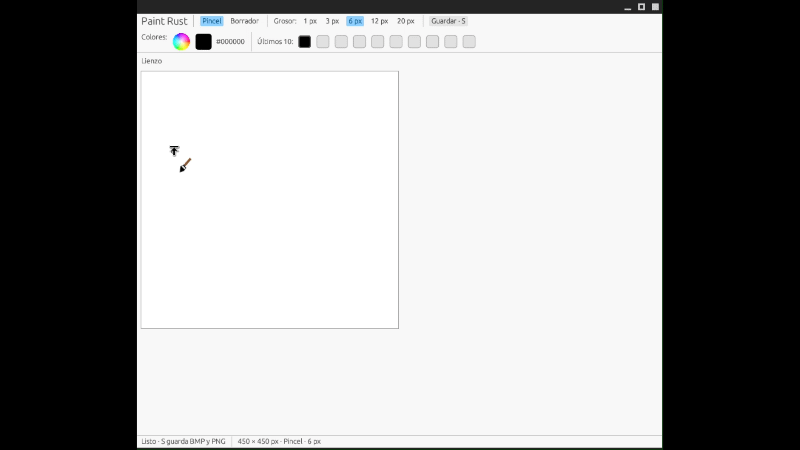
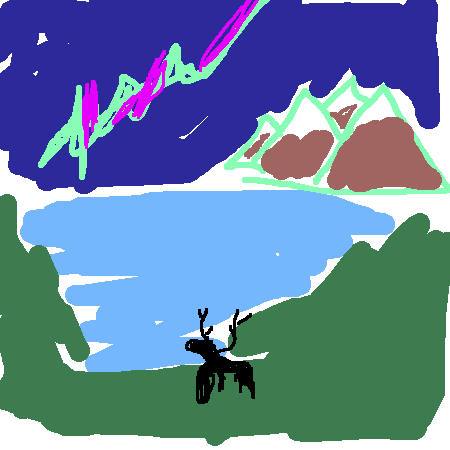

# GRF -> rust-paint
*Para ver exclusivamente lo que se pidió en la tarea ir a *[este commit](https://github.com/R-0WL/rust-paint/tree/db3f0c6cefc2090435097005b20f550bb07e4067)*
## Ejecución de programa


## Ejemplos



## Requisitos y Ejecución

### Pre-requisitos
- Tener instalado [Rust y Cargo](https://www.rust-lang.org/).
- Tener creatividad y ganas de dibujar :D

### Ejecutar el Proyecto
```bash
git clone https://github.com/R-0WL/rust-paint
cd rust-paint
cargo run --release
```


