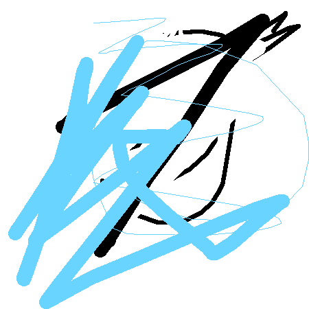

# GRF -> rust-paint

## Output



## Requisitos y Ejecución

### Pre-requisitos
- Tener instalado [Rust y Cargo](https://www.rust-lang.org/).

### Ejecutar el Proyecto
```bash
git clone https://github.com/R-0WL/rust-paint
cd rust-paint
cargo run --release
```


